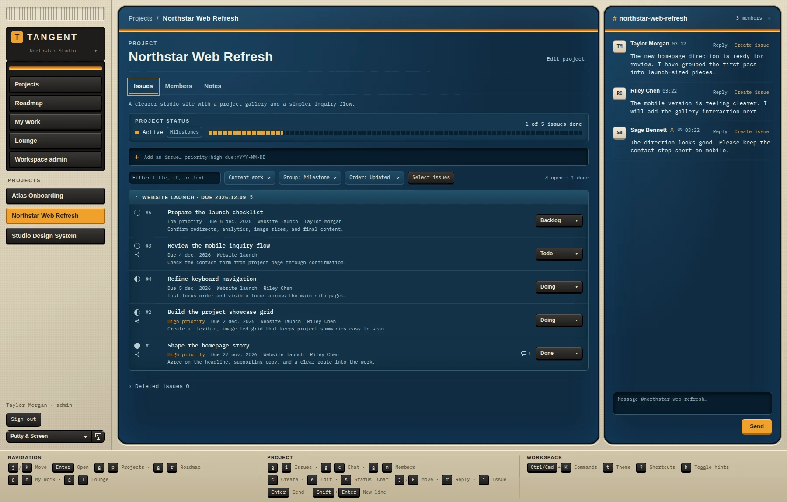
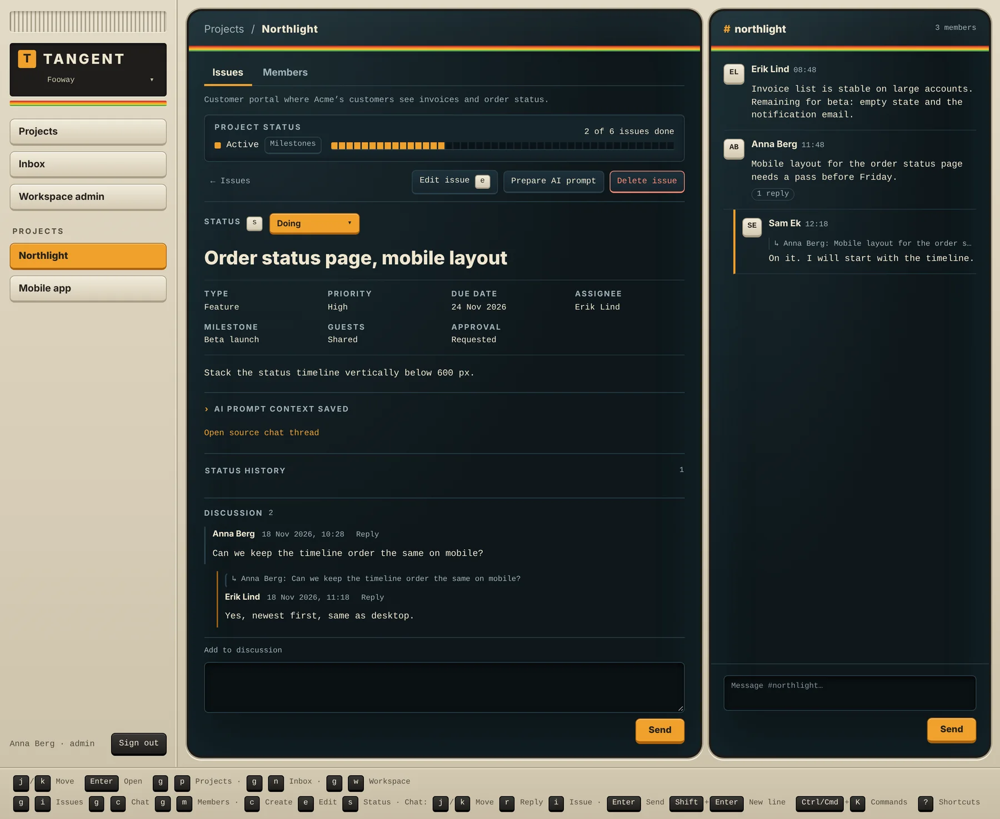
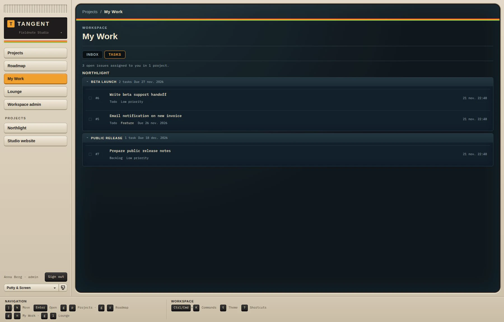
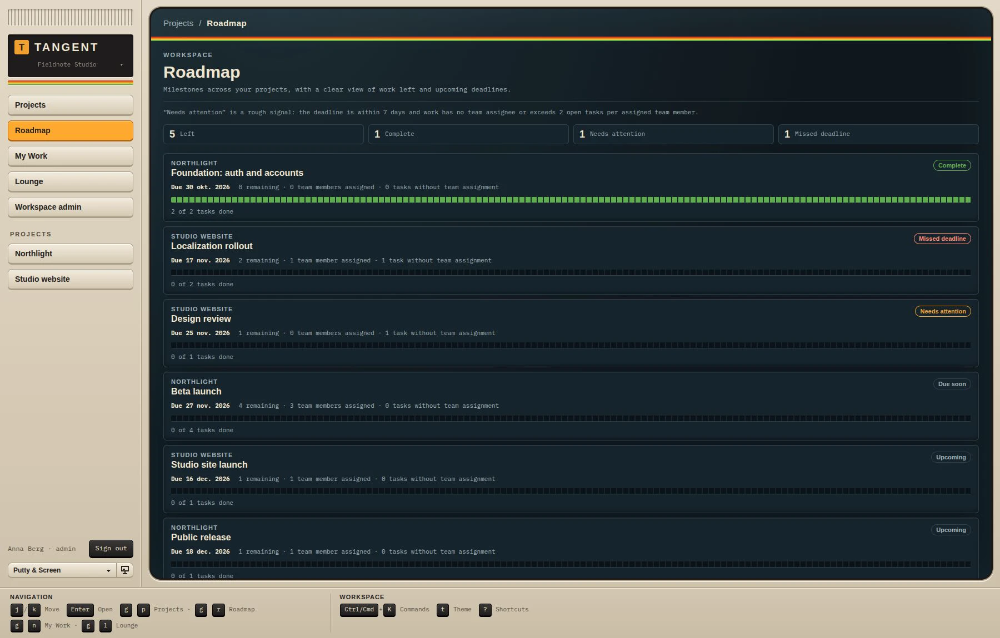
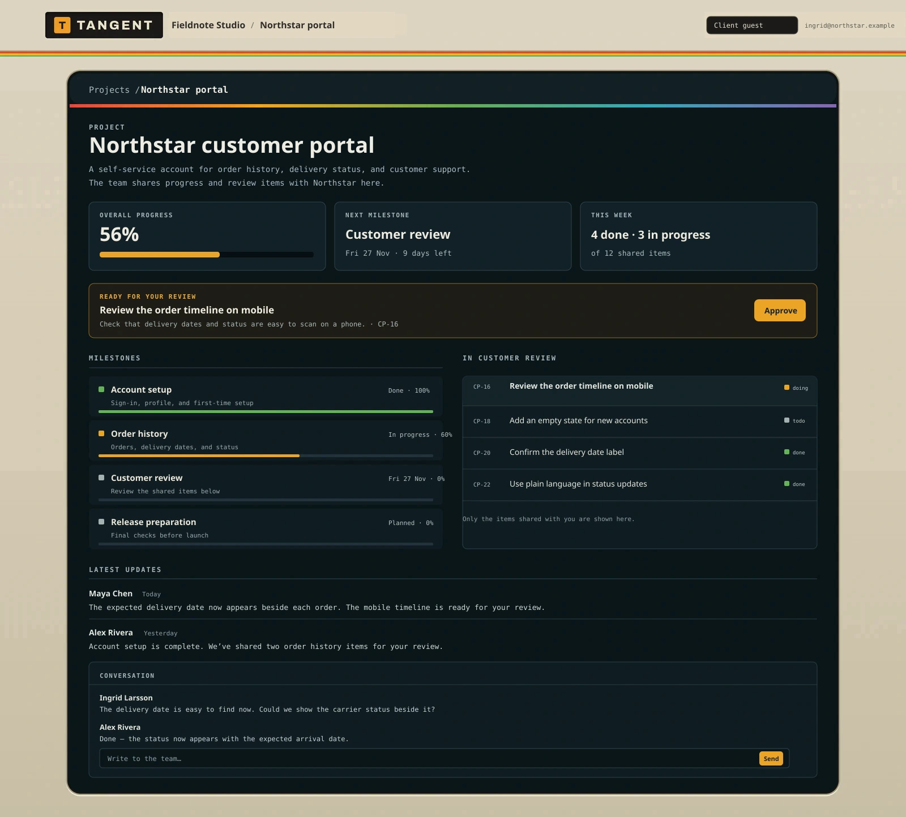

# Tangent

A keyboard-first, self-hosted workspace for small dev teams and freelancers: project chat, issues and a client portal in one place. It runs on ordinary PHP with MySQL or MariaDB.



> [!WARNING]
> **Tangent is in limited alpha.** Use it only for low-risk pilot testing; avoid sensitive or important work. The database schema may change, and future upgrades may require a fresh install. There is no production release or upgrade guarantee.

## Why Tangent

- **Keyboard first.** Move, open, change status, create and reply without the mouse. There is a command palette (`Ctrl/Cmd+K`) and a shortcut list (`?`). Hide or restore the bottom shortcut hints from the command palette; the choice is saved in this browser. Statuses are changed with a key or a menu, never by drag and drop.
- **See when someone else is around.** A small power light in project chat shows whether another authorized viewer is active, without showing names or a count.
- **Chat mentions.** Type `@` to find a project member by their saved name; selecting them inserts an exact mention and sends them an inbox notification.
- **Project notes.** Each project has one internal Markdown page for durable context, with a safe rendered preview. Guest clients cannot access it.
- **Sixteen themes.** Choose Putty & Screen, Rubber & Rainbow, Breadbin, Broadcast & Beige, Cassette & Colour, Mono & Membrane, Stripe & Signal, Paper & Rainbow, Desk & Phosphor, Silver & Speech, Blue & Byte, Cartridge & Cobalt, Nordic & Phosphor, Icon & Mouse, Copper & Chroma, or Clean, a neutral light theme, in the login, guest, or workspace view; the choice is saved in this browser.
- **Issues come out of the conversation.** Turn a chat message into an issue; the issue keeps a link back to its thread. Issues support priorities, due dates, ongoing work tracked separately from planned progress, and an optional guided AI prompt builder with copy and Markdown export.
- **Track linked pull requests.** Connect a GitHub repository to a project, manually link PRs to issues, and receive inbox updates as their state changes. Guests cannot see GitHub details.
- **My Work.** Review inbox updates or browse open issues assigned to you, grouped by project and milestone. Ongoing tasks and tasks without a milestone have separate groups. This internal workspace view is not part of the guest portal.
- **A client portal that is not your internal tracker.** Invited guests see only what you share: progress, milestones and shared items. They can comment and approve requested work. Internal issues stay hidden, and visibility is enforced in the API, not just in the interface.
- **A team roadmap across projects.** Review milestones, completed and remaining work, missed deadlines, and a clearly labeled “Needs attention” workload heuristic. This view is internal; guests do not see its signals.
- **Built to be installed by uploading files.** Plain PHP JSON API, no framework and no runtime dependencies. The frontend is static HTML, CSS and TypeScript. The release archive needs no Composer or npm on the server.
- **Self-hosted.** Your data stays on your own hosting, with strict CSP and invite-only membership.

Aimed at freelancers, small remote teams and studios that coordinate client work.









*Screenshots use fictional sample data.*

## Install on shared hosting

**Requirements: PHP 8.4.27 or later within PHP 8.** PHP 8.5.0 through 8.5.11 and PHP 9 are not supported; use PHP 8.5.12 or later on that branch. Check your host's patch level before downloading. You also need:

- PHP extensions `pdo_mysql`, `mbstring`, `iconv` and `intl`, plus Argon2id password hashing
- an empty MySQL or MariaDB database
- HTTPS enabled for the site

Steps in short:

1. Build the release archive with `php bin/build-release.php` (needs the PHP `zip` extension). It contains prebuilt assets and user documentation, including the English manual.
2. Upload it to your host and run the one-time installer.
3. Update later with the update page.

The full layout, setup-key steps and update procedure are in [INSTALL.md](INSTALL.md). The installer and update flow have been used successfully, including several upgrades, on one shared server. Other hosting providers and layouts have not yet been verified.

## Run locally (Docker)

For trying it out or developing. This is not a production setup.

```sh
docker compose up -d --build
docker compose exec php php bin/migrate.php
docker compose exec -it php php bin/seed-admin.php
```

Open [http://localhost:8081](http://localhost:8081). The seed command prompts you to create a development admin account. See [docs/DEVELOPMENT.md](docs/DEVELOPMENT.md) for tests and the frontend build.

## Status

Implemented: authentication and invites, workspaces, project chat with viewer presence, the workspace-wide Lounge for internal off-topic conversation, issue tracking, My Work with inbox events and assigned tasks, the internal team roadmap, the restricted client guest view and the shared-host installer.

Planned: GitLab links, weekly client summaries, and agent-friendly API access. See [ROADMAP.md](ROADMAP.md).

## Documentation

- [English user manual (PDF)](docs/USER_MANUAL.pdf) | [Markdown source](docs/USER_MANUAL.md)
- [Issues and AI prompt builder](docs/ISSUES.md)
- [Architecture and conventions](docs/ARCHITECTURE.md)
- [Development setup](docs/DEVELOPMENT.md)
- [GitHub pull-request tracking](docs/GITHUB.md)
- [API description (OpenAPI)](docs/openapi.yaml)
- [Installation](INSTALL.md)

## Feedback, security and contributing

- Found a bug or have feedback? Open an issue on the repository's issue tracker.
- Found a vulnerability? Please do not open a public issue; see [SECURITY.md](SECURITY.md).
- Pull requests are not being accepted yet; see [CONTRIBUTING.md](CONTRIBUTING.md).

## License

[Apache License 2.0](LICENSE)
